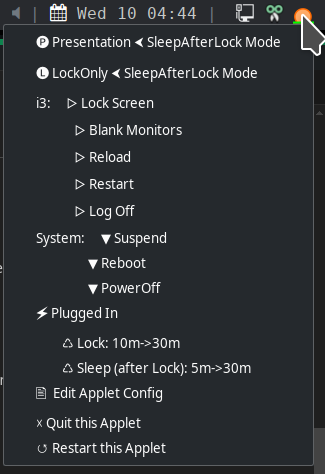

# pwr-tray

`pwr-tray` is a PyQt5 Tray Applet for Power/Energy Saving and System/DE Controls. Tested DEs include i3wm, swaywm, Hyprland, and KDE (X11 and Wayland). niri is supported by the bundled `niri-wayland` commands. Additional DEs with built-in configs: XFCE, Cinnamon, MATE, and LXQt. `systemd` is required. The `pwr-tray` menu will look similar to:

<p align="center">
  
</p>


With just a right-click and a left-click, you can do most operations such as change to Presentation Mode, change screen lock and sleep timeouts, log off, lock and blank your monitors, and more. The `pwr-tray` icon changes based on state:

*  Presentation Mode (i.e., the full sun)
*  SleepAfterLock Mode (i.e., the setting sun)
    *  SleepAfterLock Mode and Locking Screen Soon
*  LockOnly Mode  (i.e., the unlocked lock)
    *  LockOnly Mode and Locking Screen Soon
*  LowBattery State (going down).
*  Inhibited by playing media.
*  Inhibited by systemd inhibitors.

---

### Why pwr-tray?

Power management is usually configured once, per desktop, and then lived with.
The alternatives each cover part of the problem:

| Option | Covers | Gap it leaves |
|--------|--------|---------------|
| `swayidle` / `hypridle` config | Lock + sleep timers on one compositor | No on-screen state, no inhibitor visibility, no per-battery-tier policy, no manual "keep awake" toggle |
| DE power manager (Powerdevil, XFCE, Cinnamon, MATE, LXQt) | Native, integrated, vendor-maintained | Confined to its own DE; conflicts with `swayidle`-style tools; no uniform behaviour when you switch WMs |
| `systemd-inhibit` wrappers / caffeine-style tools | One-shot "don't suspend now" | No scheduling, no sequencing of lock→sleep, no feedback about *who* is inhibiting |
| Hand-rolled shell scripts | Exactly your policy | You own the state machine, the inhibit parsing, the tray, and the edge cases across DEs |

`pwr-tray` occupies the niche that table cannot fill: **one policy engine and one
tray UI across ten desktops**, with lock→sleep sequencing, per-battery-tier
timers, visible inhibition, and a manual override -- the same behaviour on i3,
sway, niri, Hyprland, KDE, XFCE, Cinnamon, MATE, and LXQt. Set the policy once
and it follows you from one WM to the next, instead of being re-learned per
desktop.

---

### Requirements
* **Python** 3.11+ with **PyQt5** (5.15+) and **ruamel.yaml** (0.17+)
* **systemd** (for `systemctl`, `loginctl`, `busctl` and `systemd-inhibit`; the `--svc-*` verbs also need a reachable `systemd --user` manager)
* **UPower** (optional but present on most desktops; its D-Bus signals carry the battery state and the AC plug as they change, which is what the applet reads instead of polling)
* **pipx** (recommended for installation)

Per-DE requirements:

| DE | Required Packages | Notes |
|----|-------------------|-------|
| **i3wm** | `i3lock`, `xprintidle`, `xset` | X11 only; `xss-lock` recommended (see below) |
| **sway** | `swaylock`, `swayidle` (1.8+) | `pwr-tray` manages `swayidle` |
| **Hyprland** | `swaylock`, `swayidle` (1.8+) | `pwr-tray` manages `swayidle` |
| **niri** | `niri`, `swaylock`, `swayidle` (1.8+) | Wayland only; `pwr-tray` manages `swayidle` |
| **KDE Wayland** | `swayidle` (1.8+) | Requires **Plasma 6**; `pwr-tray` manages `swayidle` |
| **KDE X11** | `xprintidle`, `xset` | Plasma 6 (Plasma 5 untested); `qdbus`/`qdbus6` auto-detected |
| **XFCE** | `xprintidle`, `xset` | X11 only |
| **Cinnamon** | `xprintidle`, `xset` | X11 only |
| **MATE** | `xprintidle`, `xset` | X11 only |
| **LXQt** | `xprintidle`, `xset` | X11 only |

**Distro notes:**
* Developed and tested on **Debian 13 (trixie)**. Should work on any distro with sufficiently recent packages.
* KDE Wayland support requires **Plasma 6** (uses the `org.kde.Shutdown` D-Bus API) and **swayidle 1.8+** (for `ext-idle-notify-v1` protocol support).
* Debian 12 (bookworm) and Ubuntu 24.04 ship Plasma 5 and swayidle 1.7 -- KDE Wayland will **not** work on those. i3 and sway should be fine.
* Arch Linux and Fedora 40+ ship current versions and should work for all DEs.

---

### HowTo Install and Start pwr-tray
* Basically: `pipx install pwr-tray` (exactly how depends on your installation and its state)
* From a checkout, `pipx install --editable .` makes `pwr-tray` run that tree; after editing, `pwr-tray --svc-restart` reloads the applet systemd is running.
* Manually run as `pwr-tray -o`:
    * Creates config (in `~/.config/pwr-tray/config.ini`).
    * Copies default DE commands to `~/.config/pwr-tray/commands.yaml`.
    * Detects your desktop environment. If none is recognised, it prints the
      session variables it saw, the list of known desktops, and exits -- use
      `--de NAME` to force the right one. `pwr-tray --list-des` prints every
      known desktop together with the commands it needs, marking any that are
      not currently on `$PATH`.
    * Checks the DE-dependent commands it needs and exits with an install hint
      if any are missing. Note:
      * `systemctl` is always required.
      * Playing media inhibits screen saving and sleeping over MPRIS on the
        session bus, so no extra package is needed. Install `playerctl` only as
        a fallback for a session where that bus event source is unavailable.
    * **PyQt5 is installed for you.** It is a declared dependency, and the
      published wheels bundle the Qt libraries they need, so `pipx install
      pwr-tray` (or `pip install`) is normally all there is to it. A missing
      `ModuleNotFoundError: No module named 'PyQt5'` therefore means something
      else ran pwr-tray -- usually a Python that was never set up for it. Add
      PyQt5 to *that* interpreter:
        * `pipx inject pwr-tray PyQt5` -- the pipx venv that `pwr-tray` runs from
        * `pip install PyQt5` -- inside an activated venv, or `pipx inject` as above
        * `sudo apt install python3-pyqt5` (Debian/Ubuntu), `sudo pacman -S python-pyqt5` (Arch), `sudo dnf install python3-qt5` (Fedora) -- only when you run pwr-tray with the **system** Python; a venv does not see distro packages.
      Only if pip cannot use a prebuilt wheel (an unusual CPU architecture, or a musl system such as Alpine) does it fall back to compiling PyQt5, which needs Qt development headers (e.g. `qtbase5-dev` plus `python3-dev`).

* Then, follow the "Per-DE Specific Notes" below to ensure proper operation. To just kick the tires, you can defer this until ready to go forward.
* Read the other sections for customization and everyday use.
* From the CLI, you can start pwr-tray in the background with `setsid pwr-tray`; typically, you will "autostart" `pwr-tray` when you log in however your DE/WM manages autostarts. Only one instance ever runs: if one is already running, a plain start **refuses and exits** rather than disturbing it; use `setsid pwr-tray --replace` to deliberately replace it.
* The start order between `pwr-tray` and your status bar does not matter: if the bar (waybar, polybar, ...) is not running yet, or is restarted later, the applet registers its tray icon with the bar as soon as the bar appears. No `sleep` before starting `pwr-tray` is needed.

### Command Line Options
| Option | Description |
|--------|-------------|
| `-o`, `--stdout` | Keep logging on stdout instead of `debug.log` (ignored inside a systemd unit, where stdout is the unit's own redirect). |
| `-D`, `--debug` | Enable debug mode (more frequent/elaborate logging); overrides the `debug_mode` config setting. |
| `-q`, `--quick` | Quick mode: sets lock and sleep timeouts to 1 minute and runs double-time (timers expire in 30s wall clock). Useful for testing. |
| `-e`, `--edit-config` | Open `~/.config/pwr-tray/config.ini` in `$EDITOR` (default: `vim`). |
| `-f`, `--follow-log` | Tail the log file (`~/.config/pwr-tray/debug.log`) from a terminal. |
| `--de NAME` | Force desktop detection (e.g., `--de i3-x11`, `--de sway-wayland`, `--de kde-wayland`). Useful when env vars are unreliable. |
| `--replace` | Replace the `pwr-tray` that is already running: terminate it and start in its place. Without this flag a second start refuses and exits. |
| `--list-des` | Print the known desktops and the commands each one requires, mark commands missing from `$PATH`, then exit. |
| `-b`, `--battery` | Print the detected power state -- plugged or on battery, the charge, the battery's own `status`, and every `/sys/class/power_supply` device behind it -- then exit. This is the first thing to run when the menu's battery line looks wrong. |
| `--svc` / `--svc-status` | Report the `systemd --user` unit: installed, enabled, running, and which desktops `[ServiceAllowed]` permits. Exits `0` running, `1` installed-but-stopped (or not allowed in this session), `2` not installed. |
| `--svc-install` | Record this desktop as allowed in `[ServiceAllowed]` and write the unit to `~/.config/systemd/user/` if it is missing, then reload and enable it (does not start it now). This is the only verb that writes or enables the unit. The unit runs `~/.local/bin/pwr-tray`, so the verb refuses if that launcher is missing. |
| `--svc-start` | Start the installed unit now. Enables it if it was disabled, so it returns at your next login; never writes the unit. An already-running unit is left alone; use `--svc-restart` to load new code. Refuses if `~/.local/bin/pwr-tray` is missing or this desktop is not allowed. |
| `--svc-restart` | `systemctl --user restart` the installed unit so the running applet is the one `~/.local/bin/pwr-tray` resolves to. Never installs, enables, or rewrites the unit; if the unit runs anything else, run `--svc-install` first. This is what applies `pipx upgrade` or an editable install; it says so when the launcher is a frozen copy, which no restart can update. |
| `--svc-stop` | Stop the unit. It stays enabled, so it returns at your next login. |
| `--svc-uninstall` | Record this desktop as not allowed and stop the applet; delete and disable the unit only when no desktop is allowed any more. `config.ini`, picks and logs are kept. |
| `--show-svc-file` | Print the systemd unit (a constant, the same in every desktop), then exit. Use it as a starter for a hand-installed or customized unit. |
| `-y`, `--yes` | Never prompt for the `--svc-*` verbs (needed when stdin is not a terminal). |
| `--force` | Replace or delete a unit file pwr-tray did not write; implies `--yes`. |
| `-V`, `--version` | Print the package version and exit. |

For initial setup and troubleshooting, `pwr-tray -D -o` is a good starting point.

---

### HowTo Use pwr-tray
Open the `pwr-tray` menu with a right-click. Then left-click a line to have an effect ...

Choose from three *major power modes* (to control the effects of timeouts):
- **◉ Presentation ←** -  Keeps the screen unlocked/on and system up.
- **◐ LockOnly ←** - Keeps the system up, but the screen may lock.
- **○ SleepAfterLock ←** - Allows screen locking and system to go down (the "normal" mode).

Or choose from various locking/blanking/DE operations:
- **▷ Lock Screen** - locks the screen immediately.
- **▷ Blank Monitors** - blanks the screen after locking the screen.
- **▷ Reload** - various DE-dependent actions (reload WM config, etc.).
- **▷ Log Off** - terminate your user session.

Or choose a new *system state*:
- **▼ Suspend System** - suspends the system immediately.
- **▼ Reboot System** - reboots the system immediately.
- **▼ Poweroff System** - power down the system immediately.

Next, you may see:
- **↯ Plugged In 100%** (or **█ HiBattery 87%**, or **▃ LoBattery 8%**). Shows the power state and the charge level. The percentage is always there, including a full battery on mains, which used to show the state without it. A machine with no battery has no charge to report, so it shows **↯ Plugged In** alone -- and that item is also the test cycler described under Testing.
- **♺ Chg Screen Idle: 15m->30m** - change the time to start the screen saver; each time clicked, it changes to the next choice.
- **♺ Chg System Idle: 5m->30m** - change the time to take the system down; clicking selects the next choice.
- **♫ PlayerCtl** - shows the state (not installed, enabled, disabled); if installed, a click toggles whether playing media inhibits screen locking and sleeping.

The symbols are ordinary text glyphs taken from fonts every desktop has
(DejaVu Sans, Liberation Sans), never emoji: they follow the menu's own text
colour and sit where the grouping needs them -- after a group name, or indented
with the sub-items.

Or act on the applet itself:
- **✎  Edit Applet Config** - edit the applet's .ini file.
- **≡ Open Applet Log** - show `debug.log` (and the rotated `debug.log.old`, when present) in a terminal window, following the current log with `less +F`. It is offered only when a terminal emulator can be found; see `log_viewer` below. The viewer is started in its own session -- and, when the applet runs as a systemd service, in its own transient scope -- so it keeps following the log when the applet stops or restarts.
- **☓ Quit this Applet** -  exit applet.
- **↺ Restart pwr-tray vX.Y.Z** - restart applet. It is the last entry and it carries the running version, so "which build am I running?" is answered without reading the log (which says the same thing at `START-UP` and `ENDED`).


---

### Testing pwr-tray
- Running `pwr-tray --quick` reduces the lock and sleep timeout to 1 minute (although you can 'click' the current value to try others), and `--quick` runs double-time (so 1 minute timers expire in 30s per the wall clock).
- You can run in various modes, but the default, `SleepAfterLock`, exercises the most code paths.
- Then, ensure closing the lid, hitting the power button, etc., have the desired effects.
- To test systemd inhibits: create a test inhibit with `systemd-inhibit --why="Prevent sleep for demonstration" sleep infinity`. Only an inhibitor that blocks `sleep` or `idle` shows the StopSign icon; one that only holds the power or lid key (`handle-power-key`, `handle-lid-switch`) does not, because a compositor owning an input event is not asking the session to stay awake.
- To test media inhibit: play media in any MPRIS-capable player; the `PlayingNow` icon appears, the menu's `PlayerCtl` entry changes from `Idle` to `Busy: <player>` (or `Busy: 2+<player>` when several play), and the lock/sleep timeouts are suspended until playback stops. This works without `playerctl` -- the state is read from the session bus.
- To test Hi/Lo Battery states (only on a system w/o a battery), click the battery state. It steps `Plugged In` -> `HiBattery` -> `LoBattery` -> `Plugged In`. `HiBattery` starts full and counts down to just above `lo_battery_pct`; the next click starts `LoBattery` at `lo_battery_pct` (the highest percentage that still counts as low) and counts down to 0%, where that tier's `power_down` policy can act. The menu entry is suffixed with `(TESTING)` only while it shows one of those fabricated battery states, so it cannot be mistaken for a real power state; the plugged-in state -- at start-up, or when the cycle comes back around to it -- is the machine's real state and carries no suffix.

#### The battery line looks wrong

`pwr-tray --battery` prints the reading and the devices it came from, then exits:

```
power: present=True plugged=False percent=98.3 status=discharging source=sysfs
[AC(mains,online=0) BAT0(battery,discharging,98%) CROS_USBPD_CHARGER0(usb,online=0,not charging)]
```

- `plugged` is what the menu line follows. It comes from UPower when its D-Bus
  events are available, and from `/sys/class/power_supply` otherwise -- never
  from the mains `online` flag alone, because on some machines (Chromebooks on
  `cros_ec`) that flag stays `1` while the battery says `discharging`.
- `CONFLICT(mains-vs-battery)` means exactly that disagreement; the battery wins
  and the debug log records the line above when the state changes.
- If `status` itself says `charging` while the charger is physically out, the
  kernel/EC is reporting it, not the applet. The same line is in
  `~/.config/pwr-tray/debug.log`, so it can be compared with
  `upower -i /org/freedesktop/UPower/devices/battery_BAT0` and `cat
  /sys/class/power_supply/BAT0/status`.

#### Updating pwr-tray

`pipx upgrade pwr-tray` changes the installed code; `pwr-tray --svc-restart`
makes the running service use it. The unit file itself never changes, because
it always starts `~/.local/bin/pwr-tray`.

`--svc-start` deliberately leaves an already-running, up-to-date unit alone,
and neither `--svc-start` nor `--svc-restart` rewrites the unit.

---

### HowTo Configure pwr-tray

#### config.ini
- When the program is started w/o a `config.ini`, that file is created with defaults.
- It has three sections:
    * **Settings**: The settings for when plugged in.  Missing/invalid settings are inherited from the defaults. Here are the defaults:
    * **HiBattery**: The settings for when on battery on and not a low battery condition.  Missing/invalid settings are inherited from 'Settings'.  A key absent from both sections uses the HiBattery default: `power_down = False`, `lock_min_list = [10, 20]`, `sleep_min_list = [1, 10]`.
    * **LoBattery**: The settings for when on battery in a low battery condition.  Missing/invalid settings are inherited from 'Settings'.  A key absent from both sections uses the LoBattery default: `power_down = True`, `lock_min_list = [1]`, `sleep_min_list = [1]`.

Here are the current 'Settings' defaults with explanation.
```
    [Settings]
    debug_mode = False                  # more frequent and elaborate logging
    power_down = False                  # power down (rather than suspend)
    turn_off_monitors = False           # turn off monitors after locking screen
    lock_min_list = [15, 30]            # lock minutes choices
    sleep_min_list = [5, 30]            # sleep minutes choices (after lock)
    lo_battery_pct = 10                 # define "low battery" state
    gui_editor = geany                  # gui editor for .ini file
    log_viewer =                        # terminal prefix for "Open Applet Log" (empty = auto-detect)
```
**NOTES**:
* If you have issues with monitors failing to sleep or the system cannot wake when the monitors are off, then disable the `turn_off_monitors` feature.
* You can set `gui_editor = konsole -e vim`, for example, to use vim in a terminal window.  If you don't have `geany` installed, then be sure to change `gui_editor`.
* `log_viewer` is the command prefix `pwr-tray` uses to start the log viewer inside a terminal window, e.g. `log_viewer = xterm -e` or `log_viewer = gnome-terminal --`. When empty it picks the first installed terminal it knows (x-terminal-emulator, gnome-terminal, konsole, kitty, alacritty, foot, xterm, xfce4-terminal, mate-terminal, lxterminal). The viewer is given `/dev/null` as its stdin, stdout and stderr: because the applet points its own fds 1 and 2 at `debug.log`, a terminal emulator left alone would inherit that file and append its own toolkit chatter -- konsole's Qt palette dump and `QLayout` warnings -- to the log.
* `debug.log` is the file the menu and `-f` follow, and it is capped at 2 MiB. When it grows past that, it is rotated: the current file becomes `debug.log.old`, any previous `debug.log.old` is discarded, and a fresh `debug.log` is started -- so there are never more than two log files. The applet writes this file even when a systemd unit redirected its stdout elsewhere, so the visible log never goes stale. This is also the only file `pwr-tray` rotates: `-o/--stdout` writes no log at all, and a unit pointed at some other file leaves that file for you to rotate.
* Every run brackets itself in that log with `START-UP pwr-tray vX.Y.Z pid N` and `ENDED pwr-tray vX.Y.Z pid N`, so the version and the process id can be read off the log itself. A `START-UP` with no `ENDED` below it was killed (`SIGKILL`, a crash); an `ENDED` with no new `START-UP` is simply the end of a run.
* Qt's own messages are filtered, not echoed. Qt writes to its process rather than through our logger, so a handler installed before the `QApplication` exists routes them: debug and information levels are dropped, the qt5ct/qt6ct theme's per-widget palette dump and Qt's `QThreadStorage ... destroyed` shutdown notice are dropped, and every other warning is kept -- once per distinct text -- stamped with the `[file:line]` of the C++ side Qt reports (`qt: ... [qpainter.cpp:42]`). A line in the log therefore says whether it is pwr-tray's or Qt's. That handler only covers this process, so a program the applet starts is kept out of the log by redirection instead (see `log_viewer` above).
* Edits to `config.ini` are picked up while `pwr-tray` is running; there is no need to restart it.
* Your picks of mode, timeouts, etc. are saved to disk when changed, and restored on the next start.
* Items may be absent depending on the mode and battery state.
- **NOTE**: when in LoBattery, SleepAfterLock becomes the effective mode. The icon will change per your selection and the battery state.

#### commands.yaml (DE commands)
On each startup, `pwr-tray` copies its built-in `commands.yaml` to `~/.config/pwr-tray/commands.yaml` so you can always see the current defaults. To customize DE commands (e.g., fix a logoff command, change the locker, add a new DE):

1. Copy `commands.yaml` to `my-commands.yaml` in the same folder:
   ```
   cp ~/.config/pwr-tray/commands.yaml ~/.config/pwr-tray/my-commands.yaml
   ```
2. Edit `my-commands.yaml` as needed.
3. Restart `pwr-tray`.

`pwr-tray` loads `my-commands.yaml` if it exists, otherwise falls back to the built-in `commands.yaml`. The `my-commands.yaml` file is never overwritten by `pwr-tray`.

The config uses a three-layer merge: **defaults** → **session_type** (x11 or wayland) → **desktop**. Later layers override earlier ones. Desktop entries are keyed by compound names like `i3-x11` or `kde-wayland`; the part before the last `-` is matched against environment variables (`$XDG_CURRENT_DESKTOP`, `$XDG_SESSION_DESKTOP`, `$DESKTOP_SESSION`), and the suffix must match `$XDG_SESSION_TYPE`.

---

## Running pwr-tray as a systemd Service

The `--svc-*` verbs drive **one** `systemd --user` unit that runs `~/.local/bin/pwr-tray` (created by `pipx install`). They need a reachable `systemd --user` manager; without one they refuse, and starting pwr-tray is your DE/WM's job.

The unit is a constant: it names no desktop and pins no display variable, so it is the same file on every machine and in every session. **Which desktops may run it is `[ServiceAllowed]` in `config.ini`**, because no unit file can observe the session it is started in. Quick start, once in each desktop or window manager that should have a tray:

```
pwr-tray --svc-install    # allow this desktop, write/enable the unit if missing
pwr-tray --svc-start      # show the tray now
```

That is how a machine running i3 and niri gets a tray in both, and leaves a desktop you did **not** opt in alone -- KDE in this example, because it has a working power manager of its own. Nothing privileges KDE: every name is `False` until you allow it, and running `--svc-install` *in* KDE would simply set `kde-wayland = True` like any other.

```ini
[ServiceAllowed]
# pwr-tray --svc-install sets the desktop you are logged into to True
i3-x11 = True
niri-wayland = True
kde-wayland = False
# ...every supported desktop is listed; False until you opt in
```

It is an ordinary `config.ini` section and `--svc-install` edits it **in place**, so your comments and your own sections survive. Edit it by hand whenever that is easier; only `--svc-install` (True) and `--svc-uninstall` (False) ever write it, and `pwr-tray -e` opens the file.

All the verbs print `desktops allowed:` and whether the current session is one of them; `-y/--yes` answers any prompt and `--force` replaces or deletes a unit pwr-tray did not write (and implies `--yes`).

| Verb | Effect |
|------|--------|
| `--svc`, `--svc-status` | Report installed/enabled/running, the allowed desktops, and this session. Exits `0` running, `1` installed but stopped or not allowed here, `2` not installed. |
| `--svc-install` | Record this desktop as allowed and write the unit if it is missing, then reload and enable it (does not start it). Refuses if `~/.local/bin/pwr-tray` is missing. |
| `--svc-start` | Start the installed unit now; enables it if it was disabled. Refuses when this desktop is not allowed. |
| `--svc-restart` | Restart it so the running applet is the code `~/.local/bin/pwr-tray` resolves to. Refuses when this desktop is not allowed. |
| `--svc-stop` | Stop the unit. It stays enabled, so it returns at your next login. |
| `--svc-uninstall` | Record this desktop as not allowed and stop the applet; disable and delete the unit only when no desktop is allowed any more. `config.ini`, picks and logs are kept. |

**What a disallowed desktop looks like.** The unit still starts at login; the applet re-derives the session, sees that `[ServiceAllowed]` says False for it, writes one line to `debug.log` and exits **0**. A clean exit is final for `Restart=on-failure`, so the unit ends `inactive` -- not `failed`, and not restarting -- in KDE or any other desktop you did not opt in.

**Logout is never blocked.** The unit runs `Restart=on-failure` and names the stop signals in `RestartPreventExitStatus`, bounds the stop with `TimeoutStopSec=5`, opts out of any inherited `SESSION_MANAGER`, and the applet turns SIGTERM into a normal quit. `Restart=always` is what used to make a logout hang: the applet was signalled as the session ended and systemd started it again while the session was still draining.

**Switching desktops.** Logging out and back in always works: the session manager stops `graphical-session.target` on the way out and starts it on the way in, and `WantedBy=graphical-session.target` does the rest. Switching to a *second* session that is still logged in does not -- for pwr-tray or for any other `graphical-session.target` unit such as `waybar` or `nm-applet` -- because the target belongs to the user manager and is already active, so no start job exists. Add one line to the desktop's own startup file and the tray always appears:

```
# i3, sway
exec systemctl --user start pwr-tray.service
# niri
spawn-at-startup "systemctl" "--user" "start" "pwr-tray.service"
# Hyprland
exec-once = systemctl --user start pwr-tray.service
```

`systemctl --user start` on a running unit does nothing, so the line is safe in every case; `pwr-tray --svc-start` does the same from a terminal.

### Rolling your own unit

`--svc-install` copies the shipped unit. To start from it yourself:

```
pwr-tray --show-svc-file > pwr-tray.service
```

The dump is the same text `--svc-install` writes, in any desktop. Keep `--svc-mode` on `ExecStart=`: that flag is what tells the applet a unit started it, so only a unit run obeys `[ServiceAllowed]` (a desktop autostart or a terminal run is never gated). An explicit flag and not an environment check, because `INVOCATION_ID` and friends are inherited by every child of a unit -- a terminal opened inside one would make a hand-started pwr-tray look like the service.

Then install that file however you normally install a `systemd --user` unit (for example, place it in `~/.config/systemd/user/` and run `systemctl --user daemon-reload && systemctl --user enable --now pwr-tray.service`). If you install by hand, create the folder the unit's `StandardOutput` names (`~/.config/pwr-tray` for the shipped unit). systemd opens that file but never creates its directory, so a missing folder fails the start with `status=209/STDOUT` and no applet. `--svc-install` creates it for you.

Keep one supervisor per session: do not enable the unit *and* a DE/WM autostart for the same login. The unit passes `RestartPreventExitStatus=2 3`, so a duplicate start (exit 3) or a failed startup (exit 2) is reported rather than retried.

---

## Per-DE Specific Notes

### i3wm Specific Notes
* Uninstall or disable all competing energy saving programs (e.g., `xscreensaver`, `xfce4-power-manager`, etc.) when running `i3` whether started by `systemd` or `i3/config` or whatever; defeat the X11 defaults somehow such as in `~/.config/i3/config`:
```
        exec --no-startup-id xset s off ; xset s noblank ; xset -dpms
```
* **Recommended**: Install `xss-lock` and configure it in your i3 config to handle lid close and power button events:
```
set $screenlock i3lock -t -i ~/.config/pwr-tray/lockpaper.png --ignore-empty-password --show-failed-attempts
exec --no-startup-id xss-lock --transfer-sleep-lock -- $screenlock --nofork
bindsym XF86PowerOff exec --no-startup-id $screenlock && systemctl suspend
bindsym $mod+Escape exec --no-startup-id $screenlock  # create shortcut to lock screen only
```
* Edit `/etc/systemd/logind.conf` and uncomment `HandlePowerKey=` and `HandleLidSwitch=`, set each action to `suspend`, and then either reboot or restart `systemd-logind`.
* Finally, start `pwr-tray` as a systemd service (see above) or some other way. For example, a simplest case using `i3status`, though it may depend on your status bar:
```
        bar {
            status_command i3status
            tray_output primary
        }
        exec_always --no-startup-id ~/.local/bin/pwr-tray
```
* If you use `polybar` for status, then it may be best to run `pwr-tray` from polybar's 'launch' script; e.g., `setsid ~/.local/bin/pwr-tray &`. The icon registers when polybar's tray appears, so no delay is needed.

### sway Specific Notes
* Uninstall or disable any **other** `swayidle` instances or competing energy savers. `pwr-tray` manages its own `swayidle` process and will kill any stray instances on startup.
* **NOTE**: on `sway`, `pwr-tray` cannot read the idle time directly; instead, it manages a `swayidle` process whose arguments vary with your settings.
* Edit `/etc/systemd/logind.conf` and uncomment `HandlePowerKey=` and `HandleLidSwitch=`, and set each action to `suspend`; then either reboot or restart `systemd-logind`.  That enables the ever-running `swayidle` to handle the suspend / resume events.
* Again, start `pwr-tray` as a systemd service (see above) or find another way; for example, adding to sway's config: `exec_always --no-startup-id ~/.local/bin/pwr-tray` (the icon appears once the bar's tray is up).

### Hyprland Specific Notes
* Disable any other idle managers. `pwr-tray` manages its own `swayidle` process.
* Start `pwr-tray` as a systemd service (see above) or, for example, via Hyprland's `exec-once`:
```
exec-once = ~/.local/bin/pwr-tray
```
* Screen locking uses `swaylock`; monitor control uses `hyprctl dispatch dpms`.

### niri Specific Notes
* `pwr-tray` ships a `niri-wayland` profile in `commands.yaml`. It is selected from `$XDG_CURRENT_DESKTOP`/`$XDG_SESSION_DESKTOP`, or force it with `--de niri-wayland`.
* Install `niri`, `swaylock`, and `swayidle` (1.8+). As with sway and Hyprland, disable any other idle manager: `pwr-tray` manages its own `swayidle` process and kills stray instances on startup.
* Monitor blanking uses `niri msg action power-off-monitors`. niri has no "monitors on" action because keyboard or pointer input wakes the display, so `monitors_on` is intentionally empty.
* Log off and config reload use `niri msg action quit` and `niri msg action reload-config`.
* niri handles the power key itself; the `handle-power-key` inhibitor it registers is ignored when deciding whether to show the StopSign icon.
* Start `pwr-tray` as a systemd service (see above) or from niri's `spawn-at-startup`:
```
spawn-at-startup "sh" "-c" "~/.local/bin/pwr-tray"
```

### KDE Specific Notes
* In Settings/Energy Saving, disable "Screen Energy Saving", "Suspend session", etc., except keep the "Button events handling" and make it as you wish (e.g., "When power button pressed", "Sleep").
* Start it as a systemd service (see above), or in Settings/AutoStart add the full path of `~/.local/bin/pwr-tray`.
* `qdbus` (or `qdbus6` on Plasma 6) is required for X11; `pwr-tray` auto-detects which is available.
* On **KDE Wayland**, `swayidle` is required (install it if missing). `pwr-tray` manages `swayidle` for idle timeout handling. Locking uses `loginctl lock-session`.
* On **KDE X11**, idle time is read via `xprintidle` and screen locking uses `loginctl lock-session`.

### Other DEs (XFCE, Cinnamon, MATE, LXQt)
* These DEs have built-in configs that should work out of the box on X11.
* Disable any competing energy saving features in the DE's own power settings.
* Screen locking uses `loginctl lock-session` (the DE provides the lock handler).
* If the built-in commands don't work for your setup, create a `my-commands.yaml` override (see above).
