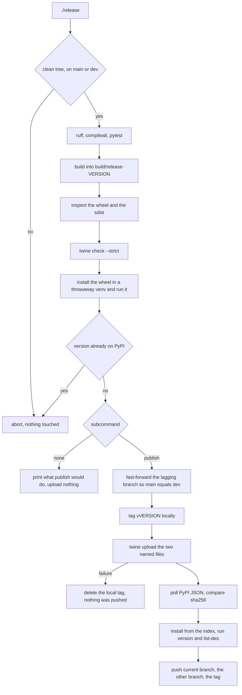

# F1 re-evaluation and release plan

Status: **plan only, nothing implemented.**
Supersedes the F1 text in `tests/AUDIT.md` and the `Releasing` sections of
`pyproject.toml` and `README-DEV.md`.

---

## 1. Constraints given by the owner

| # | Requirement | Consequence for the design |
|---|---|---|
| R1 | No TestPyPI, no staging index | Safety must be reproduced **locally**, before the single irreversible upload |
| R2 | Releases are run by hand from the development tree, low ceremony, owner-controlled | **No publish job in CI.** CI stays a gate. One local entry point does the whole release |
| R3 | License is unconstrained; reuse is a non-goal | Stay on MIT, but express it the way current packaging expects (PEP 639 / SPDX) instead of the deprecated table form |
| R4 | Work happens on `main`; `dev` exists only for an overhaul like this one | A release must leave `main` and `dev` identical at the tagged commit. `publish` aligns them itself rather than relying on the owner to remember |

---

## 2. Re-evaluation of F1: what is stale, what is not

### 2.1 Claims in the quoted finding that are no longer true

| Claim | Verified reality |
|---|---|
| `pyproject.toml` says `version = "1.0.13"` | There is no `version =` key. `pyproject.toml` declares `dynamic = ["version"]`; the only copy is `pwr_tray/__init__.py:3` and it reads **2.0.0**. Commit `d86f950` removed the duplicate. |
| The repository is uniformly ahead of the index | Only **local** `dev` is. See 2.2. |

### 2.2 Claims that remain true, and are understated

1. **The index is stale and misdescribes the package.** `https://pypi.org/pypi/pwr_tray/json`
   reports latest `1.0.12`, uploaded 2026-05-12, summary
   `A GTK tray applet for power management for i3/sway/KDE`,
   `Requires-Python >=3.8`, `Requires-Dist` containing `pydbus>=0.6.0` and the
   dead marker `importlib-metadata; python_version < "3.8"`. `1.0.13` has never
   existed.
2. **The GitHub default branch reproduces the same drift.** `origin/main` is
   `b1b9735` (2026-10-12). It is an ancestor of `dev`, i.e. 32 commits *behind*.
   Its tree has a hardcoded `version = "1.0.12"`, the GTK summary, `>=3.8`,
   `docs/examples/*.service`, `PrtUtil.py`, `YamlDump.py`, and no `tests/` and
   no `.github/`. The front page currently shows exactly what PyPI serves.
3. **The 2.0.0 work has never been pushed.** Local `dev` is 29 commits ahead of
   `origin/dev`.
4. **No release tag exists.** The only tag is `latest` -> `0ca65a2`
   (2024-07-04), which is not a version and is stale.
5. **The documented release procedure does not work.** `python -m build`
   succeeds (`pwr_tray-2.0.0`, `Metadata-Version: 2.5`, `Import-Name: pwr_tray`),
   but `python -m twine check dist/*` **fails** with
   `InvalidDistribution: Invalid distribution metadata: unrecognized or malformed field 'import-name'`.
   The declared floor `twine>=5` permits twine 6.1 / packaging 25.0, which
   validate core metadata only up to 2.4. `twine 7.0` / `packaging 26.3` passes
   both artifacts, and PyPI already serves 2.5, so the index is not the problem.
6. **`dist/` accumulates and the recipe uploads all of it.** Fourteen ignored
   artifacts (`1.0.3` ... `1.0.12`) sit in `dist/`, so `twine upload dist/*`
   re-sends published files and aborts on `File already exists`.
7. **The sdist is not testable.** 33 entries, no `tests/`, no `conftest.py`.
8. **No CI step inspects the index.** `tests.yml` builds and inspects
   distributions and stops there.

Current tree health: `332 passed in 1.16s`, ruff clean, working tree clean.

---

## 3. Design: a local release gate instead of a publish job

`./release` is a **full dry run**: every stage up to and including the
already-published check, then a printed checklist of exactly what `publish`
would fast-forward, tag, upload and push. `./release publish` runs the same
stages and, only if all of them pass, does the irreversible part.

There is no other flag. `--upload --tag --push` were three spellings of one
intent that always had to be typed together, so the script now takes the intent.

`publish` does not prompt for confirmation. The confirmation is the dry run plus
the typed word: a prompt is satisfied by reflex about as easily as a subcommand,
and it is one more way to stop the run halfway through.

### 3.1 Stages and their refusals

| Stage | Refuses when | Runs in |
|---|---|---|
| preflight | working tree dirty; `HEAD` already tagged `v<version>`; `twine < 7` or a `packaging` that cannot parse Metadata 2.5; `python -m build` unavailable | both |
| gates | ruff, `compileall` or pytest fail (same three gates as CI, same interpreter) | both |
| build | builds into `build/release-<version>/`, wiped first, so nothing older can be uploaded | both |
| inspect | summary != `pyproject` description; version != `__version__`; `Requires-Python` != `>=3.11`; `Requires-Dist` set differs from the three declared; `pydbus` present; resources or systemd units missing from the wheel; `tests/` missing from the sdist; `__pycache__`, `.venv` or `tests/` present in the wheel | both |
| check | `twine check --strict` fails | both |
| smoke | the freshly built wheel does not print `__version__` from `--version`, or `--list-des` does not list `sway-wayland` | both |
| index-check | `pwr_tray.<version>` already appears in the PyPI JSON `releases` map (read-only, before anything is uploaded) | both |
| branch-check | 3.2 below: not on `main` or `dev`, detached `HEAD`, the two branches diverged, or a push target that is not an ancestor of `HEAD` | publish (dry run prints the verdict) |
| tag | `git tag v<version>` fails because the tag exists locally after all | publish |
| upload | `twine upload` returns non-zero; the tag from the previous stage is deleted again | publish |
| verify-index | after upload, the JSON does not report that version, or the summary / `requires_python` / `Requires-Dist` / keywords differ, or the index wheel's SHA256 differs from the uploaded file | publish |
| publish-git | any push is rejected | publish |

### 3.2 The branch model, enforced before tagging (R4)

The owner works on `main` and drops to `dev` only for an overhaul like this one,
so the invariant a release must leave behind is: **`main` and `dev` are the same
commit, and that commit is tagged.** `publish` establishes it before it uploads
anything.

| Local state at preflight | What `publish` does |
|---|---|
| on `main`, `dev` behind | fast-forwards `dev` to `main` |
| on `dev`, `main` behind (today, and after any overhaul) | fast-forwards `main` to `dev` -- the "make them the same first" step |
| `main` and `dev` at the same commit | nothing to align |
| `main` and `dev` diverged | refuses, prints both tips, and says to merge or rebase until one contains the other |
| on any other branch, or detached `HEAD` | refuses |
| `origin/main` or `origin/dev` not an ancestor of `HEAD` | refuses, because that push would not be a fast-forward on the server |

Both branches are local refs, so aligning them is free, instant and reversible.
Only the pushes at the end touch the network, and each is a fast-forward of a
ref that already existed. The dry run prints the same verdict ("would
fast-forward `main` to `99a9472`") without moving anything.

State at the time of writing, for reference: `main` and `origin/main` are both
`b1b9735`, `dev` is `99a9472` and 29 commits ahead, and `origin/dev` trails it by
the same 29. So the first `publish` puts the overhaul on the default branch as a
by-product of releasing it.

### 3.3 Why this is an acceptable substitute for TestPyPI (R1)

TestPyPI would catch: (a) a malformed distribution, (b) a version that already
exists, (c) a `pip install` that resolves to something broken, (d) metadata the
index itself rejects.

Locally: (a) `twine check --strict` with a validator at least as new as the
metadata writer, (b) the duplicate check runs **before** any byte leaves the
machine, (c) an install-and-run smoke of the exact wheel, (d) is the one thing
not reproducible locally, and it is already demonstrated by precedent: PyPI
currently serves `Metadata-Version: 2.5` for `flit_core 4.2.0`. If PyPI were to
reject a 2.5 field, the fallback is a one-line pin to `flit_core<4`, which
emits Metadata 2.4; the script must print that fallback in its upload-error
message.

The residual risk the local script removes that TestPyPI never could: uploading
a *stale* file, because it uploads two explicitly named paths, not `dist/*`.

---

## 4. Work items

### 4.1 Packaging metadata and tool floors

`pyproject.toml`:

* `requires = ["flit_core>=3.12,<5"]`. Measured, not assumed: with this project
  flit_core 3.11.0 and 3.12.0 emit `Metadata-Version: 2.4`, while 4.2.0 emits
  `2.5` plus `Import-Name: pwr_tray`. An unbounded `>=3.4` therefore resolves to
  4.x today and produces the metadata that `twine 6.1` rejects; the `<5` bound
  stops a future 5.x from changing the format again without notice. `3.12` is
  the oldest backend kept in the tested range (3.11 also honours the SPDX form).
* dev extras: `twine>=7` and an explicit `packaging>=26`, replacing
  `twine>=5`. The validator must never be older than the writer.
* `[tool.flit.sdist] include = ["pwr_tray/resources/", "tests/", "conftest.py"]`.
* License, per R3 and PEP 639: `license = "MIT"`, `license-files = ["LICENSE"]`,
  and drop the now-redundant `License :: OSI Approved :: MIT License`
  classifier, because Metadata 2.4 and later carry `License-Expression`. The
  fallback if a backend ever rejects the SPDX form is `license = { text = "MIT" }`;
  nothing about the MIT grant changes either way.
* Replace the six-step `Releasing` comment with `./release` and one sentence of
  rationale.

### 4.2 A single distribution inspector, shared by the script and CI

Move the inline heredoc currently at `tests.yml` (build, inspect distributions)
into one importable helper, `tests/inspect_dist.py`, with functions
`wheel_metadata()`, `check_wheel()`, `check_sdist()`. Both `./release` and the
CI packaging job call it, so the two cannot drift. No `pwr_tray/` module is
added, so nothing extra ships in the wheel.

### 4.3 `./release`

Root-level executable `python3` script, in the style of `runner`: module
docstring stating the contract, one positional argument with two choices
(`publish`, or nothing for the dry run), no flags, no third-party imports beyond
`twine` and `build` being *present as executables*. Stage functions are pure
enough to test: `preflight()`, `gates()`, `build()`, `inspect()`, `check()`,
`smoke()`, `index_version_exists()`, `branch_plan()`, `align_branches()`,
`tag()`, `upload()`, `verify_index()`, `publish_git()`.

`branch_plan()` is a pure function taking the current branch, the other branch
and the SHAs involved, and returning either a refusal reason or the single ref
to fast-forward. That is what makes the table in 3.2 testable without a git
remote, and it keeps the decision out of the shell-outs that act on it.

### 4.4 Tests

`tests/test_release.py` (new, no network, no uploads):

* dirty tree is refused;
* a version present in a fake index JSON is refused;
* only the freshly built two files are ever passed to upload;
* the sdist contains `tests/` and `conftest.py`; the wheel does not;
* wheel summary equals the `pyproject` description and `pydbus` is absent;
* `publish` is the only mode that reaches `twine upload`, `git tag` or
  `git push`: the default mode calls none of them;
* `branch_plan()` accepts `dev` ahead of `main` and `main` ahead of `dev`,
  naming the lagging branch for a fast-forward in both cases, and refuses two
  diverged tips, a third branch, a detached `HEAD` and a push target that is not
  an ancestor of `HEAD`;
* the tool floors in `pyproject.toml` are the ones the script asserts.

`tests/test_metadata.py` (extend):

* description names every DE key present in `commands.yaml` (or at minimum
  `niri` and `hyprland`) and still contains no `gtk`;
* `requires-python` is `>=3.11`; no `pydbus` in dependencies;
* `license-files` names `LICENSE`.

`tests/test_repo_hygiene.py` (extend):

* `./release` exists and is executable;
* no file in the repository, and no documented command, says
  `twine upload dist/*`.

### 4.5 CI: gate only, never publish

`tests.yml` keeps its three jobs. The packaging job switches to the shared
inspector and gains two assertions: the wheel `Summary` equals the `pyproject`
description, and `Requires-Dist` contains no `pydbus`. No secrets, no OIDC, no
upload, no environment.

### 4.6 Documents

* `tests/AUDIT.md`: replace F1 with the verified text from section 2, and fix
  section 7 item 1, which still instructs a `pyproject.toml` version edit and a
  1.0.13 tag.
* `README-DEV.md`: the `Releasing` section becomes `./release`, plus a short
  `Why not a release workflow` paragraph recording R1 and R2 as decisions so
  the next audit does not re-file this as a defect.
* `README.md`: until 2.0.0 is on the index, `pipx install pwr-tray` fetches the
  GTK-era 1.0.12 with `pydbus`. Say so, point at
  `pipx install --editable .`, and remove the note in the release commit.

### 4.7 One-time repository correction

The branch half of this is now the script's job: the first `publish`
fast-forwards `main` to `dev` and pushes both, so the 29 local commits reach
`origin/dev` and the default branch ends up showing what the index serves,
without a separate manual push.

What remains manual, once:

* `git tag -d latest` and `git push origin :refs/tags/latest` -- the tag points
  at a 2024 commit and is not a version.

Then the first real release: `./release` (read the checklist), `./release
publish`.

---

## 5. Explicit non-goals

* No CI publish job, no Trusted Publishing, no OIDC, no protected environment:
  a single maintainer auditing two named files locally is stronger than a
  workflow that can only see what it just built.
* No TestPyPI round trip (R1).
* No changelog, no release notes automation, no artifact signing beyond what
  twine/PyPI already attest.
* No post-release monitoring: `./release` verifies immediately after upload;
  later drift is out of scope for a package with this traffic.

## 6. Residual risks

| Risk | Mitigation |
|---|---|
| 2.0.0 upload is irreversible | dry run is the default and prints every stage's verdict; the duplicate check runs before any byte is sent; the script uploads two named files, never `dist/*`; PyPI yank is the only real undo |
| PyPI rejects a Metadata 2.5 field | precedent shows 2.5 is accepted; error message in `./release` names the `flit_core<4` fallback |
| A release from an uncommitted tree makes the tag a lie | preflight requires a clean tree |
| Local validator older than local builder | `twine>=7` / `packaging>=26` floors, asserted by the script and by a test |
| `main` drifts again | `publish` aligns `main` and `dev` before tagging and pushes both in the same command; a test pins that pairing |
| The upload succeeds but a push does not | the tag is created before the upload and deleted again if the upload fails, so the index never runs ahead of a tag; a push failure after a successful upload prints the exact `git push` commands, and the index is still correct |
